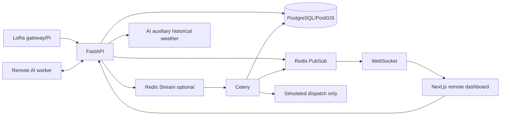
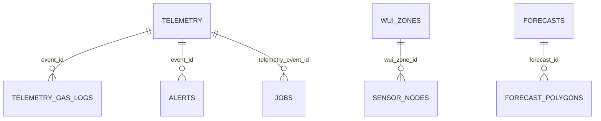

# EDGE-FIRE 백엔드 최종 개발 보고서 초안 (W15)

## 개발 개요
원격 팀 환경에서 센서 관측을 중앙 서버에 저장하고 프론트에 전달하며, AI 담당자 PC의 이미지 모델에 작업을 전달하는 연구 시제품. 운영용 산불 경보가 아니다.

## 구조

## ERD (logical)

Additional tables: workers, wui_assets, ptz_commands, vision_metadata, dispatch_log. Logical links are not a claim of enforced foreign keys. Telemetry unique key node_id, boot_id, seq. WUI geometry is operator supplied; sample data is explicitly demo.

## API 산출물
- docs/API_CONTRACT.md, docs/WBS_6_15.md, docs/EDGEFIRE.postman_collection.json
- `python scripts/export_openapi.py` or live `/openapi.json` (3.1)
- WBS additions: registry, gas history, missing sequence ranges, cache, command/dispatch history, relay candidates, event-based forecast.

## 검증 기록
SQLite test suite 14 passed. Synthetic integrated API pipeline passed; not a real hardware/model/agency test. See TEST_RESULTS.txt.

| KPI | 계획 | 실측 |
|---|---:|---|
| Spatial nearby | <=10 ms | 미측정 |
| Ingestion | >=1000 TPS | 미측정 |
| Response delay | <=50 ms | 미측정 |
| NPU inference | 20 ms | 미측정 |
| Dispatch queue | >=2000/s | 미측정 |
| Failover loss | 0 | 합성 순번 테스트만, 실환경 미측정 |

## 시연 검수
1. Docker PostGIS/Redis 정상, API /health OK, Celery worker/beat 실행.
2. Tailscale FE/HW/AI 접근, 인증키 역할 분리.
3. HW JSON 입력 또는 synthetic sender → 저장 조회 → WS/차트 → 시각/좌표 확인.
4. PTZ 명령 생성(미전송 표시), 사진 작업 → 실제 AI 워커 결과(검증 전 모델 표기).
5. 기존 AI 기상 자료 제공 시 확산 layer 조회. 모의 전파만 실행. 모든 실제 발송 기능 비활성.
6. 재전송/누락 검사와 시연 영상. KPI는 테스트 CSV에서 실측값을 확인한 뒤 기입.

실환경 결과가 없으면 해당 항목 미완료/후속 개발로 남긴다. 실제 기관 전파는 승인된 규격 및 테스트 계정 확보 후 별도 검토.
